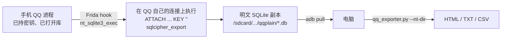

# qq-nt-mobile-exporter

现存有Github项目，用于导出电脑QQ的聊天记录。但是有些重要的聊天记录只存在于手机上，腾讯只提供「手机 → 电脑」的**备份**，没有反向的「导入」，而且那份备份是 QQ 自己的私有加密容器（伪 SQLite 头 + 高熵正文），用现有项目解不开。

我恰好有这一方面的需求，于是指挥豆老师，创建了这个项目。

可以把**安卓手机 QQ（NT 版）的聊天记录**导成可读的 HTML / TXT / CSV。

## 来源与致谢

- 思路参考（明文导出同一条路）：
  - [Android QQ NT 版数据库解密](https://blog.yllhwa.com/2023/09/29/Android%20QQ%20NT%20%E7%89%88%E6%95%B0%E6%8D%AE%E5%BA%93%E5%8A%AF%E5%AF%86) —— 最早指出 `ATTACH + sqlcipher_export` 这条路
  - [Yosooiiii/qq-chat-exporter: 导出PC端QQ聊天记录](https://github.com/Yosooiiii/qq-chat-exporter)——沿用了该项目的ui，核心代码
  - [QQDecrypt](https://qqbackup.github.io/QQDecrypt/decrypt/decrypt_db.html)
  - [myth.cx: QQ NT 数据库](https://myth.cx/p/qq-nt-db/)
  - [Frida SQLCipher 明文导出片段](https://sahildhar.github.io/blogpost/frida-snippets/)

---

## 免责声明

- 本项目仅用于**导出使用者本人账号、本人设备**上的聊天记录（数据可携带权）。
- **不得**用于获取他人聊天记录、绕过他人设备安全机制、或任何侵犯他人隐私的行为。
- 需要 root 与 Frida，操作有导致 QQ 数据损坏/账号异常的风险，**请先自行备份**，风险自负。
- 请遵守你所在地区的法律法规与腾讯的服务条款。

---

## 效果

实测一台 Android 15 / arm64 的手机，QQ 2025-09 版：

| | |
|---|---|
| 会话 | 156 个（136 好友 + 20 群） |
| 消息 | 153,657 条 |
| 体积 | 24.3 MB HTML（离线自包含，双击即看） |
| 耗时 | 手机端约 1 分钟，电脑端导出 25 秒 |

导出的每个会话是一个独立 HTML，另外带一个 `index.html` 目录页。

---

## 原理



三个关键事实（也是这个项目能成立的全部原因）：

1. **加密库的实现在 `libbasic_share.so`，符号还在**，只是被改名成 `nt_sqlite3_open / _open_v2 / _key / _key_v2 / _exec / _prepare_v2 / _close` 这一组。
   （`libkernel.so` 里也有一份 SQLCipher，但那边的符号被完全剥掉了，`Module.findExportByName(null, 'sqlite3_exec')` 只会命中系统明文的 `libsqlite.so`，永远看不到 QQ 的库。）
2. **不能拿 key 自己开库**。这个定制 SQLCipher 在标准格式之上还加了 1024 字节扩展头（`nt_sqlite3_init_extheader` / `read_extheader`），自己 `open_v2 + key` 再导出会稳定得到 `rc=26 file is not a database`。必须借 QQ 已经建好的连接，让它内部按自己的格式解。
3. **手机版消息正文的编码和电脑版不一样**。正文在 `nt_msg.db` 的 `40800` 列（protobuf），电脑端 `45101` 里是嵌套结构，手机端 `45101` 里是**原始 UTF-8 字节**。原导出器只认电脑版，直接读会把所有正文渲染成「[无文本内容]」。本仓库加了 `mobile_text()` 分支解决这个问题。

详细字段/结构说明见 [`docs/原理.md`](docs/原理.md)。

---


## 环境要求

此部分自行搜索教程

| 需要 | 说明 |
|---|---|
| 手机已 root | 能 `su -c id` 拿到 `uid=0`（Magisk / KernelSU 都行） |
| `frida-server` | 与 QQ 进程 ABI 一致（一般 arm64-v8a），版本与电脑端 `frida` 一致 |
| adb | 电脑能 `adb devices` 看到设备 |
| Python 3.9+ | `pip install -r requirements.txt`（手机端链路只需要 `frida` / `frida-tools`） |

> 我使用的是DirtyFragX临时root的，项目链接https://github.com/dugongzi/DirtyFragX
>
> KernelSU作为授权进程，项目链接https://kernelsu.org/zh_CN/
>
> 获得到临时root后，在Kernel超级用户里给shell授权root


## 使用教程

### 1.创建临时输出目录

cmd里面输入下列命令

```bash
adb shell su -c "mkdir -p /sdcard/Android/data/com.tencent.mobileqq/files/qqplain"
# 如果 QQ 写不进去（输出目录属主不对），就用下面这一条：把属主改成 QQ 自己的 uid：
adb shell su -c "chown $(adb shell su -c 'stat -c %U /data/data/com.tencent.mobileqq'):ext_data_rw /sdcard/Android/data/com.tencent.mobileqq/files/qqplain"
```

### 2. 起 frida-server

`su -c "nohup ... &"` 拿不到持久进程（进程会立刻消失）。实测唯一稳定的姿势是让 adb 一直挂着：

```powershell
Start-Process -FilePath adb -ArgumentList 'shell su -c "/data/local/tmp/frida-server -l 0.0.0.0:27042"' -WindowStyle Hidden
adb forward tcp:27042 tcp:27042
```

```bash
# 或者 Linux / macOS
adb shell su -c "/data/local/tmp/frida-server -l 0.0.0.0:27042" &
adb forward tcp:27042 tcp:27042
```

### 2. 挂 hook，让 QQ 自己导出

```bash
cd mobile
python run_frida_export.py            # 重启 QQ 并 attach
python run_frida_export.py --no-restart   # 或 attach 已在跑的 QQ
```

看到这些行就说明成功：

```
[手机] [就绪] nt_sqlite3_exec @ 0x...
[手机] [打开] nt_msg.db
[手机] [密钥] nt_sqlite3_key len=32 hex=...
[手机] [成功] nt_msg.db -> /sdcard/Android/data/.../qqplain/nt_msg.db
[手机] [成功] profile_info.db -> ...
```

`nt_msg.db`（正文）和 `profile_info.db`（好友昵称）在启动阶段就会自己出现。
**群名和群成员昵称**要额外一份 `group_info.db`：手机上点开「联系人 → 群聊」页，脚本会捕捉到它的打开并自动导出。

> 想导全部会话的话，`buddy_msg_fts.db` / `group_msg_fts.db` 可以不导 —— 正文本来就在 `nt_msg.db` 里。

### 3. 拉回电脑

```bash
adb pull /sdcard/Android/data/com.tencent.mobileqq/files/qqplain ./qqplain
```

### 4. 导出 HTML

图形界面：

```bash
python qq_exporter.py --nt-dir ./qqplain --uin 10000
```

批量（推荐，无需开浏览器）：

```bash
python export_all.py --nt-dir ./qqplain --out ./out_html --fmt html
python export_all.py --nt-dir ./qqplain --out ./out_txt  --fmt txt
python export_all.py --nt-dir ./qqplain --out ./out_csv  --fmt csv
```

`--only` 可以只导指定会话：`--only 1053150006,u_ku5nMWNwe57ZA22S3g1BXA`

---

## 目录结构

```
qq-nt-mobile-exporter/
├── mobile/                    # 手机端链路(本仓库新增)
│   ├── frida-qq-nt-export.js  # hook 脚本: 借 QQ 的连接导明文
│   └── run_frida_export.py    # 驱动: 起 QQ / attach / 收日志 / 早停
├── tools/
│   └── analyze_libkernel.py   # 换版本后符号找不到时, 用字符串交叉引用定位(可选)
├── docs/
│   ├── 原理.md                # 库结构、字段、40800 编码细节
│   └── 使用说明.md            # 逐步操作 + 全部踩坑点
├── qq_exporter.py             # 电脑端导出器(第三方, 本仓库做了手机端适配)
├── export_all.py              # 批量导出封装
├── ui.html                    # 导出器前端页面
└── requirements.txt
```

对 `qq_exporter.py` 的改动集中在四处，都做了向后兼容（不影响原本导电脑端记录）：

| 改动 | 作用 |
|---|---|
| `--nt-dir / --key / --uin` 与 `LOCAL_DB_DIR` / `LOCAL_KEY` / `LOCAL_UIN` | 直接读某个本地库目录，跳过电脑端账号扫描 |
| `_is_plain_db()` | 文件头是 `SQLite format 3\0` 就直读，不再尝试解密 |
| `export_items` 里 FTS 库改为可选 | 缺 `*_fts.db` 不再抛错（手机端经常抓不到） |
| `mobile_text()` + `_walk` / `_read_varint` | 解手机版 `40800 → 45101` 的原始 UTF-8 正文 |

---

## 常见坑（都已验证，别再踩一遍）

| 现象 | 原因 / 正确做法 |
|---|---|
| `Module.findExportByName(null, 'sqlite3_exec')` 是 null | 必须按模块找：`模块.findExportByName('nt_sqlite3_exec')` |
| hook 到了 `libsqlite.so`，只看到明文小库 | 那是系统库。QQ 的加密库在 `libbasic_share.so` |
| 自己 `open_v2 + key` 后导出 → `rc=26 file is not a database` | 定制扩展头，只能借 QQ 的连接 |
| `dev.spawn()` 超时 / spawn 后 QQ 停后台、库不打开 | 改用 `am start -n com.tencent.mobileqq/.activity.SplashActivity` + `dev.attach(pid)` |
| 脚本里的 `console.log` 一条都收不到 | Python 端收不到，必须 `send()` |
| `frida.enumerate_devices()` 看不到手机 | `adb forward tcp:27042` + `add_remote_device('127.0.0.1:27042')` |
| `su -c "nohup ... &"` 起的 frida-server 立刻消失 | 用 adb 前台挂住（见「快速开始」） |
| `adb shell "cat /proc/net/tcp"` 挂死 | 这类命令别用；adb 卡死就 `kill adb` 后 `adb start-server` |
| `uiautomator dump` 写 `/sdcard/` 失败 | 写 `/data/local/tmp/ui.xml` 再 pull |
| 导出报 `table buddy_list already exists` | 输出目录里有上次的旧库，先删掉同名文件再导 |
| 正文全是「[无文本内容]」 | 手机版编码没解，见上面第 4 条改动 |

---

## 已知限制

- **媒体不解出本体**：语音、图片、视频、文件只留 `[语音]` `[图片]` `[视频]` `[文件 xxx]` 标记，文件实体在 QQ 自己的缓存目录里，不在数据库里。
- **退群/被踢成员显示「成员」**：`group_member3` 只保存当前在群成员，历史消息里的已退群者查不到昵称。
- **表情**：留 `[表情]` 占位。
- **只在特定版本实测过**（QQ 2025-09 / Android 15 / arm64）。换大版本后如果 `nt_sqlite3_*` 名字变了，用 `tools/analyze_libkernel.py` 重新定位。

---

## 安全提示

导出的明文 `.db` **就是完整聊天记录本身**，任何 SQLite 工具都能直接打开：

```bash
# 导完就删手机端副本
adb shell su -c "rm -rf /sdcard/Android/data/com.tencent.mobileqq/files/qqplain"
```
